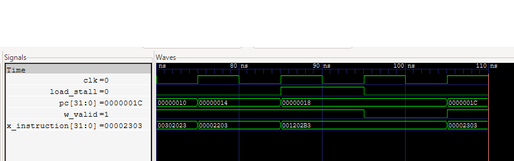

# Three-Stage Pipelined RISC-V Processor

A 32-bit processor implementing an RV32I subset in SystemVerilog, with a Python assembler and Icarus Verilog simulations.

## Design

| Stage | Function |
| --- | --- |
| Fetch (F) | Read the instruction at the program counter. |
| Decode/execute (X) | Decode, read registers, perform ALU operations, and resolve branches. |
| Memory/writeback (W) | Complete loads, stores, and register writes. |

The register file contains 32 registers with two read ports and one write port. Register `x0` always reads as zero.

The pipeline uses forwarding for ALU and jump results. Load dependencies introduce a one-cycle stall, holding PC and X while the load completes. Taken branches and jumps discard the fetched sequential instruction.

## Supported instructions

`ADD`, `SUB`, `ADDI`, `AND`, `OR`, `XOR`, `LW`, `SW`, `BEQ`, `BNE`, and `JAL`.

`EBREAK` stops the simulation. The assembler also accepts `NOP`, encoded as `ADDI x0, x0, 0`.

## Run

Requires Python 3 and Icarus Verilog, with both `iverilog` and `vvp` on PATH.

From the project folder, run all four programs:

```powershell
py tools/run.py
```

To run the hazard program and save its waveform:

```powershell
py tools/run.py hazards --wave
```

Open `build/hazards.vcd` in GTKWave. On Linux/macOS, replace `py` with `python3`. Generated files are saved in `build/`.

## Load-use stall waveform



PC and the execute-stage instruction hold for one cycle during the load dependency. After the load writes back, W becomes an empty slot, shown by `w_valid = 0`.

## Tests

| Program | Expected result |
| --- | --- |
| [sum.s](programs/sum.s) | Store 55 at byte address 0. |
| [fibonacci.s](programs/fibonacci.s) | Store the first ten Fibonacci values, from 0 through 34. |
| [array_sum.s](programs/array_sum.s) | Store 11 at byte address 20. |
| [hazards.s](programs/hazards.s) | Check forwarding, load dependencies, branches, JAL, x0, and halting. |

The testbench checks all 32 registers, all 256 data-memory words, and the completed store count.

The simulations were verified on Linux with Icarus Verilog 12.0. The Windows commands have not yet been verified.

## Limitations

- Separate 1 KiB instruction and data memories, with combinational reads and no wait states.
- Aligned 32-bit loads and stores only.
- No multiplication/division, CSRs, interrupts, or caches.
- EBREAK halts the core rather than raising a standard breakpoint exception.
- Verification is through RTL simulation; no FPGA implementation or hardware timing measurements are included.

See the [code walkthrough](docs/WALKTHROUGH.md) for implementation details. Instruction encodings follow the [RISC-V RV32I specification](https://docs.riscv.org/reference/isa/unpriv/rv32.html).